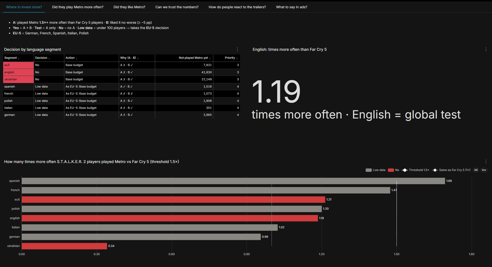
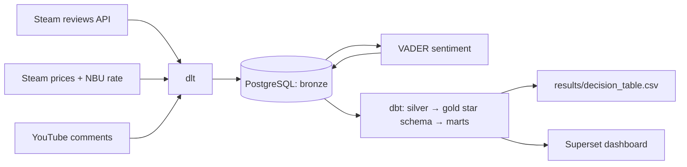

# Metro 2039 × S.T.A.L.K.E.R. 2: Where to Spend More on Ads

**English** · [Українська](README.uk.md)

Metro 2039 is coming, and the ad budget is limited. This project checks one hypothesis on public Steam data: **are S.T.A.L.K.E.R. 2 players a "warm" audience for Metro?** If they are, the language segments where they stand out should get more ad money.

## Answer

**Base budget in all 7 language segments.** English is Steam's whole world, so it is the global test: English-speaking S.T.A.L.K.E.R. 2 players played Metro only **1.19×** more often than Far Cry 5 players, below the **1.5×** threshold. The hypothesis was not confirmed.

📄 Full report: [report/report.md](report/report.md) · 📊 Decision table: [results/decision_table.csv](results/decision_table.csv)

| Segment | Decision | Action | Played Metro, × vs Far Cry 5 players |
| --- | --- | --- | --- |
| english | No | Base budget | 1.19 |
| ukrainian | No | Base budget | 0.34 |
| spanish | Low data | As EU-5: Base budget | 1.69 |
| french | Low data | As EU-5: Base budget | 1.47 |
| polish | Low data | As EU-5: Base budget | 1.20 |
| italian | Low data | As EU-5: Base budget | 1.02 |
| german | Low data | As EU-5: Base budget | 0.96 |
| *EU-5 combined* | *No* | *Base budget* | *1.21* |

## Dashboard

Apache Superset, 6 tabs, one question per tab: where to invest more · did they play Metro more often · did they like Metro · can we trust the numbers · trailer reactions · what to say in ads.



## How the decision is made

**Segments** are 7 Steam review languages: English, Ukrainian, German, French, Spanish, Italian, Polish. Plus a fallback row, **EU-5** (German, French, Spanish, Italian and Polish together).

For each segment, we ask **two questions**:

1. **Did they play Metro more often?** (the main question)
   We compare S.T.A.L.K.E.R. 2 players with "ordinary" shooter players: Far Cry 5 players. In each group, we count the share of people who also reviewed Metro.
   ✅ The answer is yes if this share is **at least 1.5 times higher** among S.T.A.L.K.E.R. 2 players and the difference is **not random** (a statistical test checks this).
2. **Did they like Metro?** (a safety check)
   We compare the share of positive Metro Exodus reviews: S.T.A.L.K.E.R. 2 players vs people who played only Metro.
   ✅ The answer is yes if the share among S.T.A.L.K.E.R. 2 players is **no more than 5 percentage points lower**.

**What this means for the budget:**

| Label | When | Budget |
| --- | --- | --- |
| **Yes** | both answers are yes | increase |
| **Test** | played Metro more often, but liked it noticeably less (by more than 5 pp) | test the increase with an A/B test first |
| **No** | did not play Metro more often | base |
| **Low data** | too few people to decide (under 100 in a group) | takes the EU-5 decision |

**Fair play:** the rule was committed to Git **before** I saw any results: [docs/decision_rule.md](docs/decision_rule.md), Oct 20, 2026, commit `f246ce6`. So the thresholds were not tuned to the data. The file is in Ukrainian; its labels map as Так = Yes, Тестово = Test, Ні = No, Мало даних = Low data.

*For analysts:* two-proportion z-test with `|z| ≥ 2.69` (Bonferroni correction for 7 segments), 95% confidence intervals. Low data also applies when a group has fewer than 10 cases of an outcome. All numbers are on dashboard tab 4.

## Architecture



- **dlt:** incremental Steam ingestion with retries, parallel chunks and schema contracts.
- **dbt:** 18 models, 7 seeds, 1 snapshot (SCD2 prices), 63 data tests + 2 unit tests, a model contract on `mart_decision`, source freshness, an exposure for the dashboard.
- **Superset:** the dashboard is stored as code in `superset/export/` and imported automatically by `run_all.py`.

**Stack:** Python 3.12 · dlt 1.30 · PostgreSQL 16.15 · dbt-core 1.12.5 (dbt-postgres 1.11) · Apache Superset 6.1.0 · Docker Compose · vaderSentiment 3.3.2

## Run it yourself

### What you need

- **Git**, to download the repository.
- **Docker Desktop**, installed and running. It runs PostgreSQL and Superset.
- **Python 3.12**.
- **Internet access.** The data is not stored in Git: `run_all.py` downloads it from public APIs during the run (Steam reviews and prices, NBU exchange rate, YouTube comments).
- **Free ports 5433** (PostgreSQL) **and 8089** (Superset).
- **Optional: a YouTube Data API key.** It is needed only for dashboard tab 5 (trailer reactions). Without it, everything else works, including the decision.

Tested on Windows 11. **TODO after the clean-run test:** how long the first run takes.

### Steps

1. Download the repository:
   ```bash
   git clone https://github.com/Daria-Baranova/metro-stalker-analytics.git
   cd metro-stalker-analytics
   ```
2. Copy `.env.example` to `.env` and fill in the values:
   - `POSTGRES_USER`, `POSTGRES_PASSWORD`, `POSTGRES_DB`: any values;
   - `SUPERSET_SECRET_KEY`: a long random string;
   - `SUPERSET_ADMIN_PASSWORD`: make up a password; you will use it to log in to the dashboard;
   - `HASH_SALT`: a random string (Steam IDs are stored only as hashes);
   - `YOUTUBE_API_KEY`: optional, see [How to get a YouTube key](#how-to-get-a-youtube-key). Leave it empty to skip YouTube.
3. Start the database and Superset:
   ```bash
   docker compose up -d
   ```
4. Install the Python packages in a virtual environment:
   ```bash
   python -m venv .venv
   ```
   Activate it: `.venv\Scripts\activate` on Windows, `source .venv/bin/activate` on macOS or Linux. Then:
   ```bash
   pip install -r requirements.txt
   ```
5. Run the whole pipeline:
   ```bash
   python run_all.py
   ```
6. Open the dashboard. It runs **on your own computer**: open http://localhost:8089 in a browser and log in.
   - Username: `admin`
   - Password: the one you wrote in `.env` on the `SUPERSET_ADMIN_PASSWORD` line.

**Without a YouTube key,** `run_all.py` prints a warning and skips the YouTube and VADER steps, and dbt skips the 4 comment models and their tests. The decision and dashboard tabs 1–4 and 6 work as usual. The two charts on tab 5 show an error because their tables do not exist.

**Reference result:** compare your run with [results/decision_table.csv](results/decision_table.csv). Small differences are possible: Steam deletes and edits reviews.

### How to get a YouTube key

The key is free, and each person uses their own. Never commit `.env` to Git (it is already in `.gitignore`).

1. Sign in to [Google Cloud Console](https://console.cloud.google.com/) with a Google account.
2. Create a new project.
3. Open **APIs & Services → Library**, find **YouTube Data API v3** and click **Enable**.
4. Open **APIs & Services → Credentials → Create credentials → API key**.
5. Recommended: edit the key and under **API restrictions** allow only **YouTube Data API v3**.
6. Paste the key into `.env`: `YOUTUBE_API_KEY=your_key`.

One run uses about 100 of the 10,000 free daily quota units (about 9,300 comments, 100 per request).

## Repository

```
├── docker-compose.yml   # PostgreSQL + Superset
├── run_all.py           # runs every step in order and logs the duration
├── ingest/              # dlt pipelines: Steam reviews, prices, YouTube
├── analysis/            # VADER, manual check, CSV export
├── dbt/                 # silver, gold, marts, tests, snapshot, exposure
├── superset/            # Dockerfile, dashboard export / import
├── docs/                # decision rule (committed before the analysis)
├── results/             # decision_table.csv
└── report/              # report (EN + UA) and screenshots
```

## Limitations

- **Steam only:** the conclusion applies to Steam players.
- **Only some players write reviews:** the decision relies on comparison with a control game, not on absolute numbers.
- **Language ≠ country:** a segment is the review language.
- **Snapshot as of Oct 19, 2026:** a rerun may differ slightly.
- **Trailer sentiment is unreliable:** VADER was right on only 48% of 140 hand-labeled comments.

## Steam prices

Tracked as an SCD2 snapshot in dbt as a technical exercise; not used in the decision. Prices as of Oct 26, 2026; hryvnias converted to dollars at the NBU rate.

| Game | US | Ukraine |
| --- | --- | --- |
| S.T.A.L.K.E.R. 2: Heart of Chornobyl | $41.99 (−30%) | ₴979 (−30%) ≈ $21.50 |
| Far Cry 5 | $59.99 | ₴915 ≈ $20.09 |
| Metro Exodus | $29.99 | ₴799 ≈ $17.55 |
| Metro 2033 Redux | $1.99 (−90%) | ₴53 (−90%) ≈ $1.16 |
| Metro: Last Light Redux | $1.99 (−90%) | ₴53 (−90%) ≈ $1.16 |
| Metro 2039 (coming soon) | $69.99 | ₴2,199 ≈ $48.29 |

---

*I developed this project for learning purposes, using public data, to practice and improve my skills. It is not affiliated with the game developers or publishers.*
