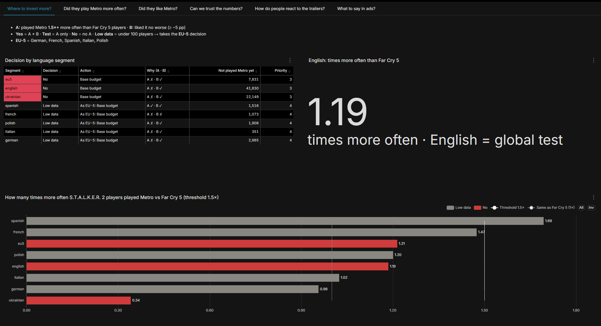
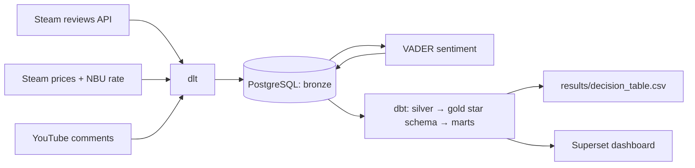

# Metro 2039 × S.T.A.L.K.E.R. 2: де вкласти більше реклами

[English](README.md) · **Українська**

Скоро виходить Metro 2039, а рекламний бюджет обмежений. Проєкт перевіряє одну гіпотезу на публічних даних Steam: **чи є гравці S.T.A.L.K.E.R. 2 «теплою» аудиторією для Metro?** Якщо так, мовні сегменти, де вони вирізняються, мають отримати більше рекламних грошей.

## Відповідь

**Базовий бюджет в усіх 7 мовних сегментах.** Англійська в Steam — це весь світ, тому вона загальний тест: англомовні гравці S.T.A.L.K.E.R. 2 грали в Metro лише **у 1.19 раза** частіше, ніж гравці Far Cry 5, а поріг — **1.5**. Гіпотеза не підтвердилась.

📄 Повний звіт: [report/report.uk.md](report/report.uk.md) · 📊 Таблиця рішень: [results/decision_table.csv](results/decision_table.csv)

| Сегмент | Рішення | Дія | У скільки разів частіше грали в Metro, ніж гравці Far Cry 5 |
| --- | --- | --- | --- |
| english | Ні (No) | Базовий бюджет | 1.19 |
| ukrainian | Ні (No) | Базовий бюджет | 0.34 |
| spanish | Мало даних (Low data) | Як «5 мов ЄС»: базовий | 1.69 |
| french | Мало даних (Low data) | Як «5 мов ЄС»: базовий | 1.47 |
| polish | Мало даних (Low data) | Як «5 мов ЄС»: базовий | 1.20 |
| italian | Мало даних (Low data) | Як «5 мов ЄС»: базовий | 1.02 |
| german | Мало даних (Low data) | Як «5 мов ЄС»: базовий | 0.96 |
| *5 мов ЄС разом* | *Ні (No)* | *Базовий бюджет* | *1.21* |

## Дашборд

Apache Superset, 6 вкладок, одне питання на вкладку: де вкласти більше · чи частіше грали в Metro · чи сподобалась Metro · чи можна вірити числам · реакція на трейлери · що казати в рекламі. Дашборд англійською.



## Як ухвалюється рішення

**Сегменти** — 7 мов відгуків у Steam: англійська, українська, німецька, французька, іспанська, італійська, польська. Плюс запасний рядок **«5 мов ЄС»** (німецька, французька, іспанська, італійська, польська разом).

Для кожного сегмента ставимо **два питання**:

1. **Чи частіше вони грали в Metro?** (головне питання)
   Порівнюємо гравців S.T.A.L.K.E.R. 2 зі «звичайними» гравцями шутерів — гравцями Far Cry 5. У кожній групі рахуємо, яка частка людей також писала відгук на Metro.
   ✅ Відповідь «так», якщо в гравців S.T.A.L.K.E.R. 2 ця частка **щонайменше в 1.5 раза більша** і різниця **не випадкова** (це перевіряє статистичний тест).
2. **Чи сподобалась їм Metro?** (запобіжник)
   Порівнюємо частку позитивних відгуків на Metro Exodus: у гравців S.T.A.L.K.E.R. 2 і в тих, хто грав лише в Metro.
   ✅ Відповідь «так», якщо в гравців S.T.A.L.K.E.R. 2 ця частка **нижча не більше ніж на 5 відсоткових пунктів**.

**Що це означає для бюджету:**

| Мітка | Коли | Бюджет |
| --- | --- | --- |
| **Так** (Yes) | обидві відповіді «так» | збільшити |
| **Тестово** (Test) | грали частіше, але Metro сподобалась помітно менше (більше ніж на 5 п.п.) | спершу перевірити збільшення A/B-тестом |
| **Ні** (No) | не грали в Metro частіше | базовий |
| **Мало даних** (Low data) | замало людей для висновку (у якійсь групі менше 100) | бере рішення рядка «5 мов ЄС» |

**Чесність:** правило записано в Git **до** того, як я побачила результати: [docs/decision_rule.md](docs/decision_rule.md), 20.10.2026, коміт `f246ce6`. Тобто пороги не підганялись під дані.

*Для аналітиків:* z-тест двох часток, `|z| ≥ 2.69` (поправка Бонферроні на 7 сегментів), 95% довірчі інтервали. «Мало даних» — також коли в групі менше 10 випадків одного з результатів. Усі числа — на вкладці 4 дашборду.

## Архітектура



- **dlt:** інкрементальне завантаження Steam з повторами, паралельними шматками і schema contracts.
- **dbt:** 18 моделей, 7 seeds, 1 snapshot (ціни, SCD2), 63 тести даних + 2 unit tests, contract на `mart_decision`, source freshness, exposure для дашборду.
- **Superset:** дашборд зберігається як код у `superset/export/` і автоматично імпортується через `run_all.py`.

**Стек:** Python 3.12 · dlt 1.30 · PostgreSQL 16.15 · dbt-core 1.12.5 (dbt-postgres 1.11) · Apache Superset 6.1.0 · Docker Compose · vaderSentiment 3.3.2

## Як запустити

Потрібні **Docker Desktop** і **Python 3.12**. Порти **5433** (PostgreSQL) і **8089** (Superset) мають бути вільні.

1. Скопіюйте `.env.example` у `.env` і заповніть значення:
   - `POSTGRES_USER`, `POSTGRES_PASSWORD`, `POSTGRES_DB` — будь-які;
   - `SUPERSET_SECRET_KEY` — довгий випадковий рядок;
   - `SUPERSET_ADMIN_PASSWORD` — придумайте пароль, з яким будете входити в дашборд;
   - `HASH_SALT` — випадковий рядок (Steam ID зберігаються лише як хеші);
   - `YOUTUBE_API_KEY` — за бажанням.
2. Запустіть базу і Superset:
   ```bash
   docker compose up -d
   ```
3. Встановіть Python-пакети у віртуальному середовищі (наприклад, `python -m venv .venv` і активуйте його):
   ```bash
   pip install -r requirements.txt
   ```
4. Запустіть весь пайплайн:
   ```bash
   python run_all.py
   ```
5. Відкрийте дашборд. Він працює **на вашому комп'ютері**: відкрийте у браузері http://localhost:8089 і увійдіть.
   - Логін: `admin`
   - Пароль: той, що ви вписали в `.env` у рядку `SUPERSET_ADMIN_PASSWORD`.

**ДОПИСАТИ після тесту з нуля:** скільки триває перший запуск; що буде без ключа YouTube.

**Еталон:** порівняйте свій запуск з [results/decision_table.csv](results/decision_table.csv). Невеликі розбіжності можливі: Steam видаляє й змінює відгуки.

## Репозиторій

```
├── docker-compose.yml   # PostgreSQL + Superset
├── run_all.py           # запускає всі кроки по черзі і записує тривалість
├── ingest/              # dlt: відгуки Steam, ціни, YouTube
├── analysis/            # VADER, ручна перевірка, експорт CSV
├── dbt/                 # silver, gold, марти, тести, snapshot, exposure
├── superset/            # Dockerfile, експорт / імпорт дашборду
├── docs/                # правило рішення (закомічене до аналізу)
├── results/             # decision_table.csv
└── report/              # звіт (EN + UA) і скриншоти
```

## Обмеження

- **Лише Steam:** висновок стосується гравців Steam.
- **Відгуки пише лише частина гравців:** рішення спирається на порівняння з контрольною грою, а не на абсолютні числа.
- **Мова ≠ країна:** сегмент — це мова відгуку.
- **Знімок на 19.10.2026:** повторний запуск може трохи відрізнятися.
- **Настрій трейлерів ненадійний:** VADER збігся з ручною розміткою лише у 48% зі 140 коментарів.

## Ціни в Steam

Зберігаються як snapshot (SCD2) у dbt — як технічна вправа; на рішення не впливають. Ціни на 26.10.2026; гривні переведено в долари за курсом НБУ.

| Гра | США | Україна |
| --- | --- | --- |
| S.T.A.L.K.E.R. 2: Heart of Chornobyl | $41.99 (−30%) | ₴979 (−30%) ≈ $21.50 |
| Far Cry 5 | $59.99 | ₴915 ≈ $20.09 |
| Metro Exodus | $29.99 | ₴799 ≈ $17.55 |
| Metro 2033 Redux | $1.99 (−90%) | ₴53 (−90%) ≈ $1.16 |
| Metro: Last Light Redux | $1.99 (−90%) | ₴53 (−90%) ≈ $1.16 |
| Metro 2039 (ще не вийшла) | $69.99 | ₴2 199 ≈ $48.29 |

---

*Проєкт розроблений мною в навчальних цілях на публічних даних, для практики й вдосконалення навичок. Не пов'язаний з розробниками чи видавцями ігор.*
