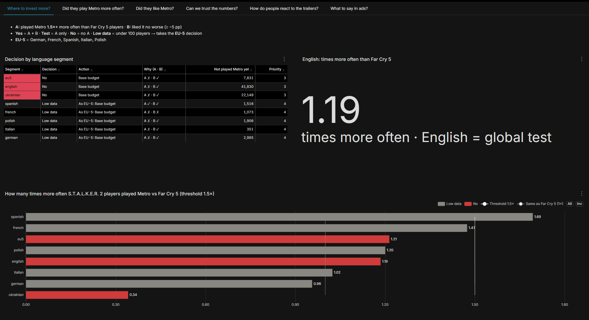
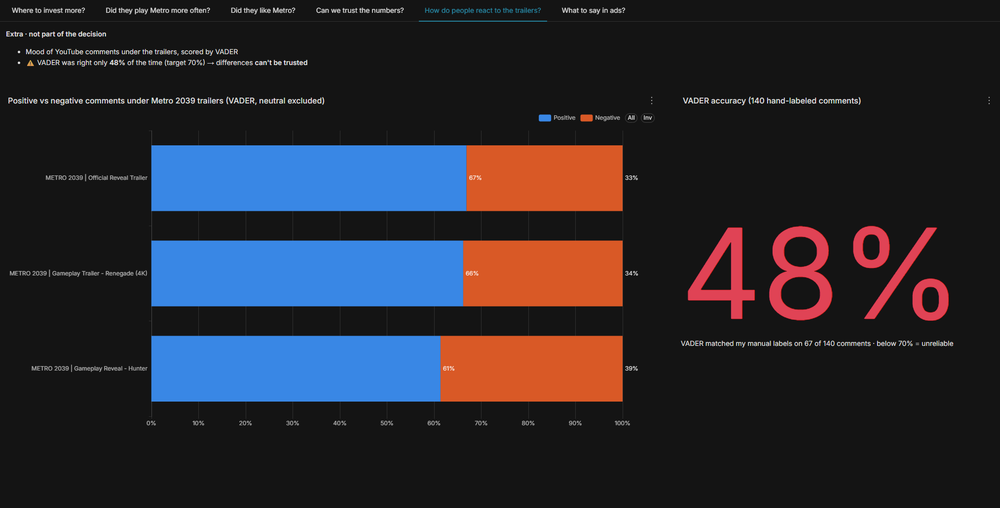
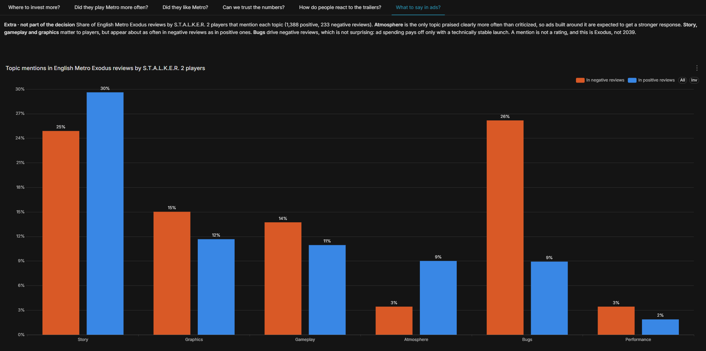

# Where to Spend More on Metro 2039 Ads Among S.T.A.L.K.E.R. 2 Players

**English** · [Українська](report.uk.md)

*Public Steam reviews, data before Oct 19, 2026 (UTC).*

## 1. Answer

I recommend the **base budget in all 7 language segments**. On Steam, S.T.A.L.K.E.R. 2 players are not a noticeably "warmer" audience for Metro than ordinary players of AAA shooters.

## 2. Decision table

| Segment | Decision | Action | Played Metro, × vs Far Cry 5 players | Not played Metro yet |
| --- | --- | --- | --- | --- |
| english | No | Base budget | 1.19 | 41,830 |
| ukrainian | No | Base budget | 0.34 | 22,149 |
| spanish | Low data | As EU-5: Base budget | 1.69 | 1,516 |
| french | Low data | As EU-5: Base budget | 1.47 | 1,073 |
| polish | Low data | As EU-5: Base budget | 1.20 | 1,906 |
| italian | Low data | As EU-5: Base budget | 1.02 | 351 |
| german | Low data | As EU-5: Base budget | 0.96 | 2,985 |
| *EU-5 combined* | *No* | *Base budget* | *1.21* | *7,831* |

- **Yes**: S.T.A.L.K.E.R. 2 players played Metro at least **1.5 times** more often than Far Cry 5 players, and the difference is not random.
- **Low data**: at least one comparison group has fewer than **100 players** (or fewer than 10 cases of one outcome). Such a segment takes the decision of the EU-5 row.
- **EU-5** = German + French + Spanish + Italian + Polish.

## 3. Why

- English-speaking S.T.A.L.K.E.R. 2 players played Metro only **1.19 times** more often than Far Cry 5 players. The difference is real, but too small to justify paying more.
- Ukrainian-speaking S.T.A.L.K.E.R. 2 players played Metro **three times less often** than Ukrainian-speaking Far Cry 5 players.
  - **Possible explanation.** S.T.A.L.K.E.R. 2 is made by the Kyiv studio GSC Game World. A very large number of people reviewed it in Ukrainian: 23 thousand reviewers vs 868 for Far Cry 5. Many of them probably bought the game to support a Ukrainian studio and rarely play similar games. This is only a hypothesis: even among very active reviewers (21+ reviews) the lift is only 0.63, so it does not explain everything.
- Players who played both S.T.A.L.K.E.R. 2 and Metro Exodus **liked Metro just as much** as those who played only Metro. In the English segment the difference is only −1.5 pp.

## 4. Global check (English)

English on Steam is the whole world, so the English segment is the **global test** of the hypothesis. "No" here means that **the warm-audience hypothesis was not confirmed**. That is why no segment gets an increased budget.

## 5. My recommendation

1. **Keep the base budget in all segments.** Increasing it is not worth it: the warm-audience hypothesis was not confirmed. Cutting it is not justified either: "No" only means that extra spending here will not pay off better than elsewhere.
2. **The Spanish segment is a candidate for testing, not for an increased budget.** S.T.A.L.K.E.R. 2 players here played Metro 1.69 times more often than Far Cry 5 players, and the difference is not random. But there is too little data for a decision: only 94 players reviewed both S.T.A.L.K.E.R. 2 and Metro Exodus (the threshold is 100). Also, the advantage appears in only one reviewer activity group (6–20 reviews), not in all of them.
3. **Next step: the publisher's own data.** The conclusion should be checked against Metro 2039 sales and wishlists by country. As an external analyst, I have no access to that data, so this step belongs to the marketing and development teams.

## 6. Limitations

- **Steam only.** I chose Steam deliberately: it is one of the largest PC platforms with public reviews. But the conclusion applies only to Steam players. Only separate studies can show whether other platforms differ.
- **Only some players write reviews.** So the true audience overlap is larger. The decision relies on comparison with a control game (Far Cry 5), not on absolute numbers, and this limitation is the same for both games.
- **Language ≠ country.** A segment is the review language, not a country. English is the whole world, so it serves only as a global test of the hypothesis.
- **The data is a snapshot as of Oct 19, 2026.** Steam deletes and edits reviews, so a rerun may differ slightly from these numbers.

## 7. Extra findings (do not affect the decision)

### Reaction to the trailers (YouTube)

- I scored about 9,300 comments under three Metro 2039 trailers with **VADER**, a rule-based word dictionary. Neutral comments (about half) are excluded.
- Share of positive comments among comments with an opinion:

| Trailer | Positive (95% CI) |
| --- | --- |
| Official Reveal Trailer | 66.9% (65.2–68.6) |
| Gameplay Trailer: Renegade | 66.2% (61.6–70.8) |
| Gameplay Reveal: Hunter | 61.4% (58.7–64.0) |

- **These shares are not reliable.** I labeled 140 comments by hand, and VADER agreed with me on only **48%** of them (67 of 140; 95% CI 40–56%), below my 70% target. It misreads gamer slang ("insane", "hell yeah"), story words ("kill") and emoji. So I cannot claim that the Hunter trailer was received worse.
- **Next step:** a pretrained machine learning sentiment model trained on social media text, checked on the same 140 labels.

### What to show in ads (topics in reviews)

English Metro Exodus reviews by players who also reviewed S.T.A.L.K.E.R. 2 in English: 1,388 positive and 233 negative. Share of reviews that mention each topic:

| Topic | In positive reviews | In negative reviews |
| --- | --- | --- |
| Story | 29.6% | 24.9% |
| Graphics | 11.7% | 15.0% |
| Gameplay | 11.0% | 13.7% |
| Atmosphere | 9.0% | 3.4% |
| Bugs | 8.9% | 26.2% |
| Performance | 1.9% | 3.4% |

- **Atmosphere** is the only topic praised clearly more often than criticized (2.6 times). Ads built around atmosphere are expected to get a stronger response from this audience.
- **Story, gameplay and graphics** matter to players: they are mentioned often. But they appear about as often in negative reviews as in positive ones, so the data does not show them as a distinct strength.
- **Bugs** are mentioned three times more often in negative reviews. This is not surprising: technical problems are a common reason for negative reviews. For marketing, it means that ad spending pays off only with a technically stable launch: ads bring players, and bugs turn them into negative reviews.
- **Limitations:** a mention is not a rating ("no bugs" also counts as a bug mention); keyword search misses synonyms; this is Metro Exodus, not Metro 2039.

---

*I developed this project for learning purposes, using public data, to practice and improve my skills. It is not affiliated with the game developers or publishers.*
