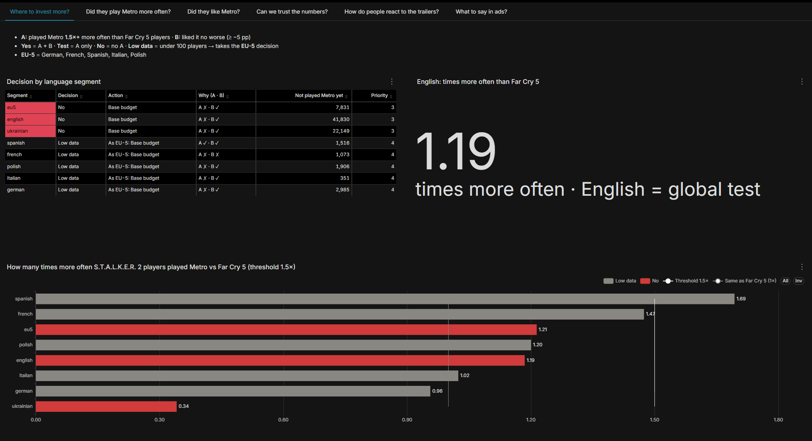
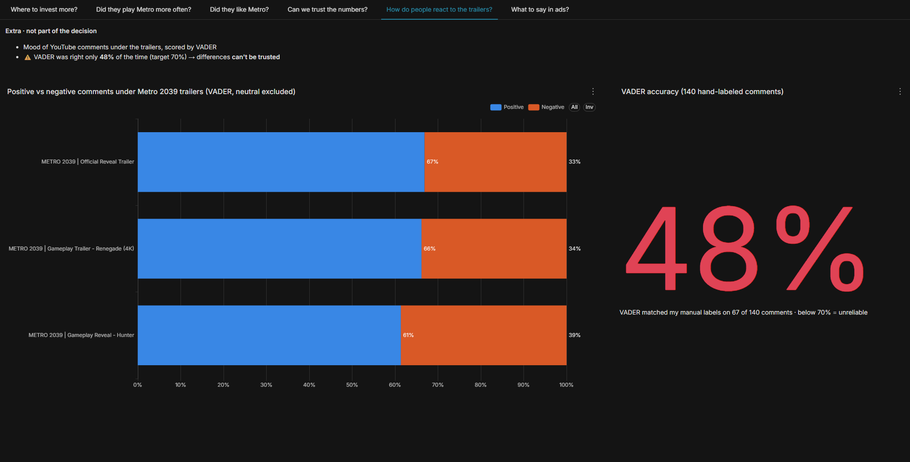
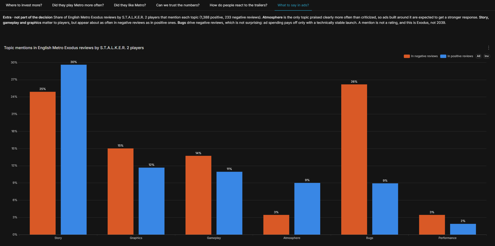

# Де вкласти більше реклами Metro 2039 серед гравців S.T.A.L.K.E.R. 2

[English](report.md) · **Українська**

*Публічні відгуки Steam, дані до 19.10.2026 (UTC).*

## 1. Відповідь

Рекомендую **базовий бюджет в усіх 7 мовних сегментах**. Гравці S.T.A.L.K.E.R. 2 у Steam не є помітно «теплішою» аудиторією для Metro, ніж звичайні гравці AAA-шутерів.

## 2. Таблиця рішень

| Сегмент | Рішення | Дія | У скільки разів частіше грали в Metro, ніж гравці Far Cry 5 | Ще не грали в Metro |
| --- | --- | --- | --- | --- |
| english | Ні (No) | Базовий бюджет | 1.19 | 41 830 |
| ukrainian | Ні (No) | Базовий бюджет | 0.34 | 22 149 |
| spanish | Мало даних (Low data) | Як «5 мов ЄС»: базовий | 1.69 | 1 516 |
| french | Мало даних (Low data) | Як «5 мов ЄС»: базовий | 1.47 | 1 073 |
| polish | Мало даних (Low data) | Як «5 мов ЄС»: базовий | 1.20 | 1 906 |
| italian | Мало даних (Low data) | Як «5 мов ЄС»: базовий | 1.02 | 351 |
| german | Мало даних (Low data) | Як «5 мов ЄС»: базовий | 0.96 | 2 985 |
| *5 мов ЄС разом* | *Ні (No)* | *Базовий бюджет* | *1.21* | *7 831* |

- **«Так» (Yes)** — гравці S.T.A.L.K.E.R. 2 грали в Metro щонайменше **у 1.5 раза** частіше, ніж гравці Far Cry 5, і різниця не випадкова.
- **«Мало даних» (Low data)** — хоча б в одній групі порівняння менше **100 гравців** (або менше 10 випадків одного з результатів). Такий сегмент отримує рішення рядка «5 мов ЄС».
- **«5 мов ЄС» (EU-5)** = німецька + французька + іспанська + італійська + польська.

На дашборді й у файлі `results/decision_table.csv` мітки англійською: Так = Yes, Тестово = Test, Ні = No, Мало даних = Low data.

## 3. Чому так

- Англомовні гравці S.T.A.L.K.E.R. 2 грали в Metro лише **у 1.19 раза** частіше, ніж гравці Far Cry 5. Різниця справжня, але замала, щоб платити більше.
- Україномовні гравці S.T.A.L.K.E.R. 2 грали в Metro **утричі рідше**, ніж україномовні гравці Far Cry 5.
  - **Можливе пояснення.** S.T.A.L.K.E.R. 2 — гра київської студії GSC Game World. Українською її купило дуже багато людей: 23 тис. авторів відгуків проти 868 у Far Cry 5. Серед них, ймовірно, багато тих, хто купив гру на підтримку української студії, а в подібні ігри грає рідко. Це лише гіпотеза: навіть серед дуже активних авторів (21+ відгуків) ліфт тільки 0.63, тож вона пояснює не все.
- Гравцям, які грали і в S.T.A.L.K.E.R. 2, і в Metro Exodus, Metro **сподобалась так само**, як тим, хто грав лише в Metro. Різниця в англомовному сегменті — лише −1.5 п.п.

## 4. Загальна перевірка (english)

Англійська мова в Steam — це весь світ, тому english — **загальний тест** гіпотези. Результат «Ні» означає: **гіпотеза про теплу аудиторію не підтвердилась**. Тому жоден сегмент не отримує посиленого бюджету.

## 5. Моя рекомендація

1. **Залишити базовий бюджет в усіх сегментах.** Збільшувати не варто: гіпотеза про «теплу» аудиторію не підтвердилась. Зменшувати теж не варто: «Ні» означає лише, що додаткові витрати тут не окупляться краще, ніж деінде.
2. **Іспанський сегмент — кандидат на перевірку, а не на посилений бюджет.** Гравці S.T.A.L.K.E.R. 2 тут грали в Metro у 1.69 раза частіше, ніж гравці Far Cry 5, і ця різниця не випадкова. Але даних для рішення замало: спільних гравців S.T.A.L.K.E.R. 2 і Metro Exodus лише 94 (поріг — 100). Крім того, перевага є лише в одній групі за активністю авторів (6–20 відгуків), а не в усіх.
3. **Наступний крок — на даних власників гри.** Варто перевірити висновок на продажах і вішлістах Metro 2039 за країнами. Як зовнішній аналітик, я не маю доступу до цих даних, тож цей крок за командами маркетингу і розробки.

## 6. Обмеження

- **Лише Steam.** Steam я обрала свідомо: це один із найбільших ПК-майданчиків із відкритими відгуками. Але висновок стосується лише гравців Steam. Чи відрізняються інші платформи, покажуть лише окремі дослідження.
- **Відгуки пише лише частина гравців.** Тому справжній перетин аудиторій більший. Рішення спирається на порівняння з контрольною грою (Far Cry 5), а не на абсолютні числа, і це обмеження однакове для обох ігор.
- **Мова ≠ країна.** Сегмент — це мова відгуку, а не країна. English — це весь світ, тому він лише загальний тест гіпотези.
- **Дані — знімок на 19.10.2026.** Steam видаляє й змінює відгуки, тому повторний запуск може трохи відрізнятися від цих чисел.

## 7. Додатково (на рішення не впливає)

### Реакція на трейлери (YouTube)

- Близько 9 300 коментарів під трьома трейлерами Metro 2039 я оцінила за допомогою **VADER** — словника слів із правилами. Нейтральні коментарі (приблизно половину) не враховано.
- Частка позитивних серед коментарів із думкою:

| Трейлер | Позитивних (95% ДІ) |
| --- | --- |
| Official Reveal Trailer | 66.9% (65.2–68.6) |
| Gameplay Trailer: Renegade | 66.2% (61.6–70.8) |
| Gameplay Reveal: Hunter | 61.4% (58.7–64.0) |

- **Цим часткам не можна довіряти.** Я вручну розмітила 140 коментарів, і VADER погодився зі мною лише у **48%** випадків (67 зі 140; 95% ДІ 40–56%), а ціль була 70%. Він не розуміє геймерського сленгу («insane», «hell yeah»), слів сюжету («kill») та емодзі. Тому стверджувати, що трейлер Hunter сприйняли гірше, не можна.
- **Наступний крок:** готова ML-модель настрою, навчена на текстах із соцмереж, з перевіркою на тих самих 140 мітках.

### Що показувати в рекламі (теми у відгуках)

Англійські відгуки на Metro Exodus від гравців, які англійською писали відгук і на S.T.A.L.K.E.R. 2: 1 388 позитивних і 233 негативні. Частка відгуків, у яких згадано тему:

| Тема | У позитивних відгуках | У негативних відгуках |
| --- | --- | --- |
| Сюжет (Story) | 29.6% | 24.9% |
| Графіка (Graphics) | 11.7% | 15.0% |
| Геймплей (Gameplay) | 11.0% | 13.7% |
| Атмосфера (Atmosphere) | 9.0% | 3.4% |
| Баги (Bugs) | 8.9% | 26.2% |
| Продуктивність (Performance) | 1.9% | 3.4% |

- **Атмосфера** — єдина тема, яку хвалять помітно частіше, ніж критикують (у 2.6 раза). Очікується, що реклама з атмосферою в центрі отримає сильніший відгук цієї аудиторії.
- **Сюжет, геймплей і графіка** для гравців важливі: про них пишуть часто. Але в негативних відгуках вони трапляються приблизно так само часто, як у позитивних, тож окремою перевагою дані їх не показують.
- **Баги** згадують утричі частіше в негативних відгуках. Це не дивно: технічні проблеми — часта причина негативних відгуків. Для маркетингу висновок такий: вкладення в рекламу окупляться лише за технічно стабільного запуску. Реклама приведе гравців, а баги перетворять їх на негативні відгуки.
- **Обмеження:** згадка ≠ оцінка («no bugs» теж рахується як згадка багів); пошук за ключовими словами пропускає синоніми; це Metro Exodus, а не Metro 2039.

---

*Проєкт розроблений мною в навчальних цілях на публічних даних, для практики й вдосконалення навичок. Не пов'язаний з розробниками чи видавцями ігор.*
